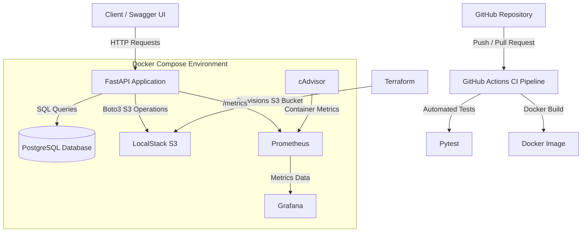
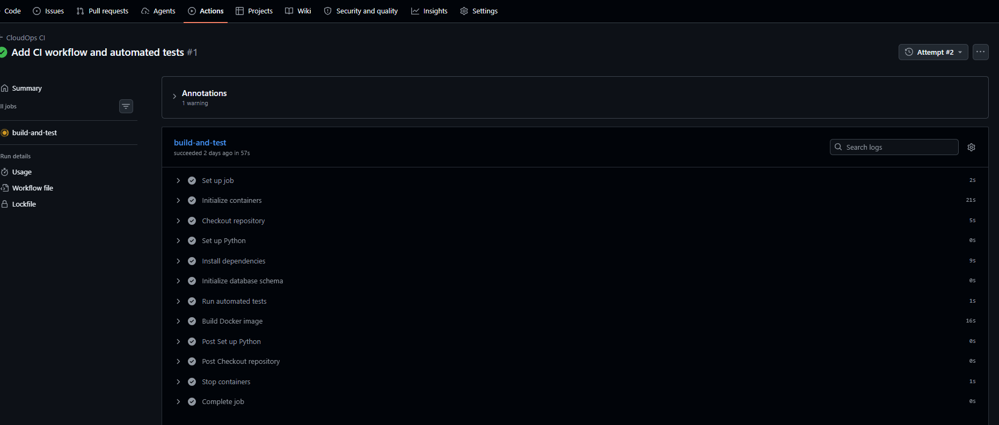
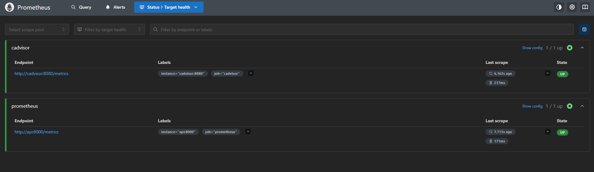
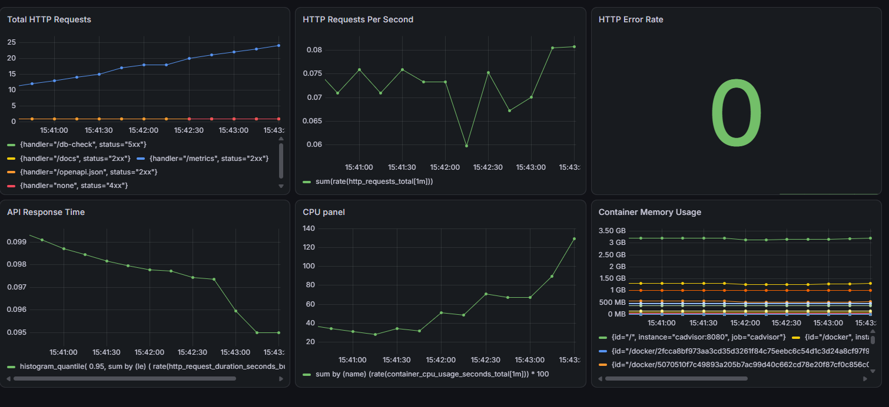
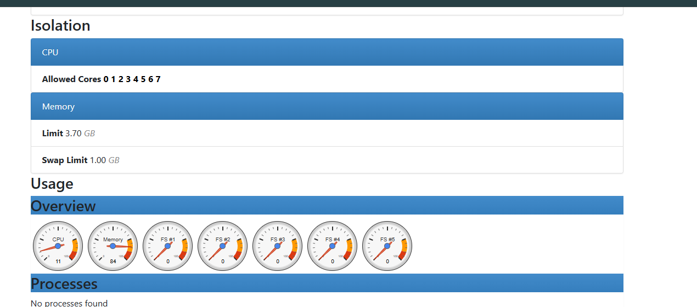
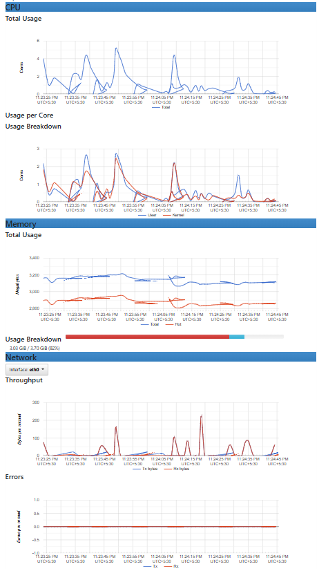
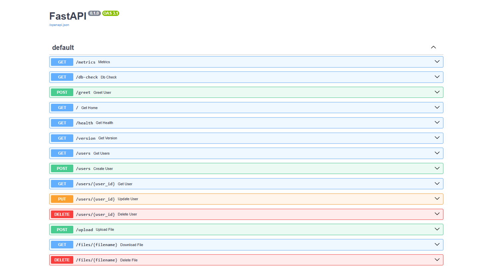

# CloudOps Project

**An end-to-end CloudOps project demonstrating application development, containerization, infrastructure provisioning, CI automation, cloud storage integration, and monitoring using practical DevOps tools and practices.**

## 1. Project Overview

The CloudOps Project is a practical implementation of a cloud-ready application built using Python and FastAPI, integrated with PostgreSQL for database management and Amazon S3-compatible object storage through LocalStack.

The application is containerized using Docker and Docker Compose, while Terraform is used for Infrastructure as Code (IaC) to provision and manage the storage infrastructure.

GitHub Actions automates application testing and Docker image building through a Continuous Integration (CI) pipeline.

To monitor application performance and infrastructure health, the project integrates Prometheus, Grafana, and cAdvisor. These tools collect, store, and visualize application-level and container-level metrics.

The primary objective is to understand how application services, databases, infrastructure, automation, cloud services, and monitoring systems work together in a practical CloudOps environment.

## 2. Project Objectives

- Develop a REST API using Python and FastAPI.
- Integrate PostgreSQL for persistent data storage and CRUD operations.
- Implement object storage operations using Boto3 and LocalStack.
- Containerize application services using Docker.
- Manage multi-container application environments using Docker Compose.
- Provision cloud infrastructure using Terraform.
- Implement automated testing and continuous integration using GitHub Actions.
- Monitor application metrics using Prometheus.
- Build monitoring dashboards using Grafana.
- Monitor container resource utilization using cAdvisor.
- Test application failure scenarios and verify service recovery.

## 3. Key Features

### 3.1 REST API Development
- Developed a RESTful API using Python and FastAPI.
- Implemented CRUD (Create, Read, Update, Delete) operations for user records.
- Used Pydantic models for request validation and data integrity.
- Implemented appropriate HTTP status codes and exception handling.
- Added application logging to record important events, errors, and API operations.
- Exposed interactive API documentation through FastAPI Swagger UI.

### 3.2 PostgreSQL Database Integration
- Integrated PostgreSQL as the relational database for storing user information.
- Used Psycopg to establish database connections and execute SQL queries.
- Implemented parameterized SQL queries to handle database operations safely.
- Configured persistent database storage using Docker named volumes.
- Verified data persistence across database container restarts and recreation.
- Implemented database error handling to return appropriate responses when the database becomes unavailable.

### 3.3 Object Storage Integration
- Integrated Amazon S3-compatible object storage using Boto3.
- Used LocalStack to simulate AWS S3 services in a local development environment.
- Implemented file upload, listing, download, and deletion operations through API endpoints.
- Configured the application to communicate with LocalStack through Docker networking.
- Used Terraform to provision and manage the S3 bucket.

### 3.4 Containerization and Service Management
- Created a Dockerfile to package the FastAPI application and its dependencies.
- Used Docker Compose to manage multiple services within a common environment.
- Configured communication between the API, PostgreSQL, Prometheus, Grafana, and cAdvisor containers.
- Used environment variables to configure application and database connections.
- Applied persistent storage and container networking concepts.

### 3.5 Infrastructure as Code (IaC)
- Used Terraform to define and provision infrastructure resources.
- Configured the AWS provider to communicate with LocalStack.
- Created an S3 bucket through Terraform configuration.
- Used Terraform initialization, validation, planning, and application workflows.
- Practiced infrastructure state inspection and configuration drift detection.

### 3.6 Continuous Integration
- Implemented a CI pipeline using GitHub Actions.
- Configured automated execution of the test suite whenever code is pushed or a pull request is created for the main branch.
- Used a PostgreSQL service container during automated testing.
- Initialized the database schema before executing tests.
- Added Docker image building to the CI workflow to verify that the application can be containerized successfully.

### 3.7 Monitoring and Observability
- Integrated Prometheus to collect application and container metrics.
- Exposed FastAPI application metrics through the `/metrics` endpoint using `prometheus-fastapi-instrumentator`.
- Configured Prometheus to scrape metrics from the API and cAdvisor.
- Integrated Grafana with Prometheus as its data source.
- Created a monitoring dashboard to visualize HTTP requests, request rates, error rates, response times, CPU usage, and memory consumption.
- Used cAdvisor to monitor container-level resource utilization.

### 3.8 Failure Handling and Recovery Testing
- Simulated API container failure and observed its effect on monitoring.
- Verified that Prometheus detects API availability changes through target health.
- Simulated PostgreSQL unavailability and verified the API's database error response.
- Restarted failed services and checked whether application connectivity was restored.
- Used these experiments to understand service dependencies, failure detection, and recovery behavior.

4. System Architecture

The CloudOps Project follows a multi-service architecture in which the application, database, object storage, CI pipeline, and monitoring components work together.

The FastAPI application acts as the central service. It receives HTTP requests, performs business logic, communicates with PostgreSQL for database operations, and interacts with S3-compatible object storage through Boto3.

Docker Compose manages the application services and provides an internal network that allows containers to communicate using their service names.

Terraform manages the S3 bucket infrastructure through the LocalStack AWS-compatible environment. GitHub Actions provides continuous integration by running automated tests and building the Docker image.

Prometheus collects application metrics exposed by FastAPI and container metrics exposed by cAdvisor. Grafana connects to Prometheus and presents the collected metrics through a monitoring dashboard.

### 4.1 Architecture Diagram



4.2 Component Interaction

1. Client to FastAPI: A client sends HTTP requests to the FastAPI application through its REST API endpoints.
2. FastAPI to PostgreSQL: The application executes SQL queries to create, retrieve, update, and delete user records.
3. FastAPI to LocalStack: The application uses Boto3 to upload, list, download, and delete files in the S3 bucket.
4. Terraform to LocalStack: Terraform provisions and manages the S3 bucket using its AWS provider configured for LocalStack.
5. FastAPI to Prometheus: Prometheus periodically collects application metrics from the /metrics endpoint.
6. cAdvisor to Prometheus: cAdvisor exposes container resource metrics, which Prometheus collects.
7. Prometheus to Grafana: Grafana queries Prometheus and visualizes the collected metrics in dashboards.
8. GitHub Actions: The CI pipeline automatically runs tests and builds the Docker image when changes are pushed or pull requests are created for the main branch. 

4.3 Architecture Design

The project separates application logic, database storage, infrastructure management, automation, and monitoring into distinct components.

This separation makes it easier to understand service dependencies, troubleshoot failures, monitor resource utilization, and maintain individual components independently.

## 5. Technology Stack

The project uses a combination of programming frameworks, databases, containerization tools, infrastructure management tools, CI automation, and monitoring solutions.

| Technology | Purpose in the Project |
|---|---|
| Python 3.12 | Primary programming language used for application development. |
| FastAPI | Framework used to build REST API endpoints and handle HTTP requests. |
| Pydantic | Used for request data validation and schema definition. |
| Psycopg | PostgreSQL adapter used to connect the Python application to the database. |
| PostgreSQL 16 | Relational database used to store and manage user records. |
| Boto3 | AWS SDK for Python used to interact with S3-compatible object storage. |
| LocalStack | Provides a local simulation of AWS services, allowing S3 operations without deploying to AWS. |
| Docker | Used to package the application and its dependencies into containers. |
| Docker Compose | Used to define, configure, and manage multiple containers as a single application environment. |
| Terraform | Infrastructure as Code tool used to provision and manage the S3 bucket. |
| Git | Version control system used to track project changes. |
| GitHub | Hosts the source code repository and manages project collaboration and version history. |
| GitHub Actions | Automates application testing and Docker image building through a CI pipeline. |
| Pytest | Testing framework used to execute automated application tests. |
| Prometheus | Collects and stores application and container monitoring metrics. |
| prometheus-fastapi-instrumentator | Exposes FastAPI application metrics through the `/metrics` endpoint. |
| Grafana | Visualizes monitoring data through dashboards and graphs. |
| cAdvisor | Collects resource utilization metrics from running containers. |

### 5.1 Why These Technologies Were Selected

- **FastAPI:** Provides a lightweight and efficient way to develop REST APIs with automatic request validation and interactive API documentation.
- **PostgreSQL:** Offers reliable relational data storage and supports structured queries and persistent records.
- **Docker and Docker Compose:** Make it possible to package the application and manage dependent services in a consistent containerized environment.
- **LocalStack and Boto3:** Allow the application to practice AWS S3 integration locally without requiring a live AWS deployment.
- **Terraform:** Introduces declarative infrastructure management and helps understand how cloud resources can be provisioned through code.
- **GitHub Actions:** Automates testing and image building, helping identify problems whenever code changes are pushed.
- **Prometheus, Grafana, and cAdvisor:** Provide visibility into application behavior, request performance, and container resource utilization.

## 6. Project Structure

The project follows an organized directory structure that separates application code, database initialization, monitoring configuration, infrastructure definitions, automated testing, and CI workflow configuration.

### 6.1 Directory Structure

```text
CloudOps_Project/
│
├── .github/
│   └── workflows/
│       └── ci.yml
│
├── database/
│   └── init.sql
│
├── monitoring/
│   └── prometheus.yml
│
├── terraform/
│   ├── main.tf
│   └── .terraform.lock.hcl
│
├── app.py
├── test_app.py
├── requirements.txt
├── Dockerfile
├── compose.yaml
├── .gitignore
└── README.md
```

### 6.1 Directory and File Description

File / Directory

## Description

- .github/workflows/
Contains GitHub Actions workflow configurations.

- ci.yml
Defines the CI pipeline, including database setup, automated testing, and Docker image building.

- database/
Contains database initialization scripts.

- init.sql
Defines the initial PostgreSQL database schema required by the application.

- monitoring/
Contains monitoring and metrics collection configurations.

- prometheus.yml
Configures Prometheus scrape intervals and monitoring targets, including FastAPI and cAdvisor.

- terraform/
Contains Infrastructure as Code configuration files.

- main.tf
Defines the AWS provider configuration and S3 bucket resource managed through Terraform and LocalStack.

- .terraform.lock.hcl
Records the selected Terraform provider versions and their dependency checksums.

- app.py
Main FastAPI application containing API endpoints, CRUD operations, database connectivity, S3 integration, logging, error handling, and metrics instrumentation.

- test_app.py
Contains automated tests used to verify application functionality and API behavior.

- requirements.txt
Lists the Python dependencies required to run the application.

- Dockerfile
Defines the instructions for building the FastAPI application Docker image.

- compose.yaml
Defines and manages the multi-container environment, including the API, PostgreSQL, Prometheus, Grafana, and cAdvisor services.

- .gitignore
Specifies files and directories that Git should exclude from version control, such as virtual environments, cache files, environment files, and Terraform state.

- README.md
Provides project documentation, architecture, setup instructions, and implementation details.

### 6.2 Generated and Local Development Files

Some directories and files are generated automatically during development and are not intended to be committed to the Git repository.

1. .venv/ – Contains the local Python virtual environment and installed dependencies.

2. __pycache__/ – Stores compiled Python bytecode files.

3. .pytest_cache/ – Stores temporary data generated by pytest.

4. terraform/.terraform/ – Contains downloaded Terraform provider plugins and related working files.

5. terraform.tfstate and terraform.tfstate.backup – Store Terraform infrastructure state information.

These files are excluded from version control through .gitignore, helping keep the repository clean and avoiding unnecessary generated files or sensitive local configuration data.

## 7. Implementation Details

This section explains the implementation of the major components of the CloudOps Project, including the REST API, database integration, object storage, containerization, infrastructure provisioning, CI pipeline, and monitoring system.

### 7.1 FastAPI Application Development

The application was developed using Python and FastAPI. FastAPI provides the framework for defining HTTP endpoints, processing client requests, validating input data, and returning HTTP responses.

The application acts as the central component of the project, connecting the client with the database and object storage services.

##### 7.1.1 REST API Implementation

A RESTful API was developed to provide structured access to application resources through HTTP methods.

The application implements the following user-management endpoints:

| HTTP Method | Endpoint | Description |
|---|---|---|
| GET | `/` | Returns the application home response. |
| GET | `/health` | Checks application health. |
| GET | `/version` | Returns the application version. |
| GET | `/db-check` | Checks database connectivity. |
| POST | `/users` | Creates a new user. |
| GET | `/users` | Retrieves all users. |
| GET | `/users/{user_id}` | Retrieves a specific user. |
| PUT | `/users/{user_id}` | Updates an existing user. |
| DELETE | `/users/{user_id}` | Deletes a user. |

These endpoints implement CRUD functionality:

Create: Adds a new user record to PostgreSQL.

Read: Retrieves all users or an individual user.

Update: Modifies an existing user record.

Delete: Removes a user record from the database.

7.1.2 Request Validation Using Pydantic

Pydantic models are used to validate incoming request data before processing it.

The user model defines the expected data structure and validation rules, including:

User names must contain between 1 and 100 characters.

Leading and trailing whitespace is removed.

Empty or whitespace-only names are rejected.

Names containing unsupported digits or special characters are rejected.

This helps prevent invalid input from reaching the database layer.

7.1.3 Database Connectivity

The application uses Psycopg to communicate with PostgreSQL.

Database connection details are supplied through environment variables, including:

1. DB_HOST
2. DB_PORT
3. DB_NAME
4. DB_USER
5. DB_PASSWORD

The application uses these settings to establish database connections and execute SQL queries.

Parameterized SQL queries are used for database operations to separate query instructions from user-supplied values.

7.1.4 Error Handling and Logging

1. Application-level error handling was implemented to manage unexpected failures.
2. HTTP 404 responses are returned when a requested user record does not exist.
3. Database connection failures are handled through a custom exception handler.
4. HTTP 503 responses are returned when the database is unavailable.
5. Logging records important application events, successful operations, and errors.
6. This improves troubleshooting and makes application behavior easier to observe.

7.1.5 Automated API Documentation

FastAPI automatically generates interactive API documentation using OpenAPI.

The Swagger UI interface is accessible at:
http://localhost:8000/docs

It allows developers to inspect available endpoints, provide request data, execute API operations, and examine responses without requiring a separate API client.

7.1.6 Application Metrics

The application integrates prometheus-fastapi-instrumentator to expose HTTP request and application performance metrics.

The metrics endpoint is available at:
http://localhost:8000/metrics

Prometheus collects these metrics at configured intervals for monitoring and visualization through Grafana.

### 7.2 PostgreSQL Database Implementation

PostgreSQL 16 was integrated into the project as the relational database management system (RDBMS) responsible for storing and managing user records.

The database runs inside a Docker container and communicates with the FastAPI application through the Docker Compose network.

Psycopg, a PostgreSQL adapter for Python, is used to establish database connections and execute SQL queries.

#### 7.2.1 Database Configuration

PostgreSQL was configured as a separate service in the `compose.yaml` file using the official PostgreSQL Docker image.

The following environment variables are used to configure the database:

| Environment Variable | Purpose |
|---|---|
| `POSTGRES_USER` | Defines the PostgreSQL database user. |
| `POSTGRES_PASSWORD` | Defines the database user's password. |
| `POSTGRES_DB` | Specifies the database name. |

The database uses the following configuration:

1. Database name: `cloudops`
2. Database user: `clouduser`
3. PostgreSQL version: `16`
4. Database port: `5432`

The FastAPI application uses corresponding `DB_*` environment variables to connect to PostgreSQL.

#### 7.2.2 Database Initialization

A SQL initialization script is maintained in the `database/init.sql` file.

This script defines the initial database schema required by the application.

Keeping database initialization separate from application code makes the database structure easier to manage and maintain.

#### 7.2.3 Application-to-Database Connectivity

The FastAPI application uses Psycopg to establish connections with PostgreSQL.

Database connection details are supplied through environment variables:

1. `DB_HOST`
2. `DB_PORT`
3. `DB_NAME`
4. `DB_USER`
5. `DB_PASSWORD`

Since both services run within the Docker Compose environment, the API connects to PostgreSQL using the Compose service name `database` as its hostname and port `5432`.

This allows the application to communicate with the database through Docker's internal networking without relying on the database container's IP address.

#### 7.2.4 Database Operations

PostgreSQL supports the user-management CRUD operations implemented through the REST API.

The application performs the following database operations:

1. Inserting new user records.
2. Retrieving all user records.
3. Retrieving an individual user using its ID.
4. Updating existing user information.
5. Deleting user records.

Parameterized SQL queries are used to safely pass user-provided values to database operations.

The application also uses SQL `RETURNING` clauses where appropriate to retrieve affected records after database modifications.

#### 7.2.5 Persistent Database Storage

Docker named volumes were configured to preserve PostgreSQL data beyond the lifecycle of an individual database container.

The named volume `cloudops-postgres-data` is mounted at:

`/var/lib/postgresql/data`

This directory is the PostgreSQL data directory inside the container.
Using a named volume ensures that database records are stored independently of the container's writable filesystem.
The persistence mechanism was verified by removing and recreating the database container and checking whether previously stored records remained available.

#### 7.2.6 Database Failure Handling

Database availability is important for the correct functioning of the application.
A custom exception handler was implemented to handle PostgreSQL errors.

The following behavior was implemented:

1. Database-related operations fail when PostgreSQL becomes unavailable.
2. The application logs the database error.
3. The API returns an HTTP 503 (Service Unavailable) response.
4. The response contains an appropriate database availability message.

This prevents unexpected database failures from being returned as unhandled application errors.

#### 7.2.7 Failure Simulation and Recovery Testing

Database failure and recovery were tested by manually stopping and restarting the PostgreSQL container.

The following sequence was performed:

1. The PostgreSQL container was stopped.
2. A database connectivity request was sent to the `/db-check` endpoint.
3. The application returned an HTTP 503 response indicating database unavailability.
4. The PostgreSQL container was restarted.
5. The `/db-check` endpoint was accessed again.
6. The application successfully re-established database connectivity.

The successful recovery response was:

```json
{
  "database": "Connected",
  "result": 1
}
```

This experiment demonstrated database failure detection, application-level error handling, and recovery after the database service became available again.


#### 7.3 Docker and Docker Compose Implementation

Docker was used to containerize the FastAPI application and its supporting services. Containerization provides an isolated and consistent environment in which application components can run independently.

Docker Compose was used to define and manage the multi-container environment, allowing the application, database, and monitoring services to operate together.

##### 7.3.1 Docker Image Creation

A `Dockerfile` was created to define the instructions required to build the FastAPI application image.

The Docker image packages the application code, Python runtime dependencies, and required configuration.

The image is built using the Docker build process and can be used to create application containers.

##### 7.3.2 Containerizing the FastAPI Application

The FastAPI application runs inside a Docker container rather than depending directly on the host Python environment.

The application container exposes port `8000`, allowing clients to access the API through the host machine.

The container runs the application using Uvicorn, an ASGI server for Python applications.

##### 7.3.3 Multi-Container Management Using Docker Compose

The `compose.yaml` file defines the services required by the project.

The following services are managed through Docker Compose:

| Service | Purpose | Port |
|---|---|---|
| API | Runs the FastAPI application. | 8000 |
| Database | Runs the PostgreSQL database. | 5432 |
| Prometheus | Collects and stores monitoring metrics. | 9090 |
| Grafana | Visualizes monitoring data through dashboards. | 3030 |
| cAdvisor | Collects container resource utilization metrics. | 8080 |

Docker Compose allows these services to be started, stopped, and managed through a single configuration file.

##### 7.3.4 Container Networking

Docker Compose creates an internal network that allows containers to communicate with each other.

Services can communicate using their Compose service names instead of requiring manually assigned container IP addresses.

For example:

1. The FastAPI application connects to PostgreSQL using the hostname `database` and port `5432`.
2. Prometheus accesses application metrics using the hostname `api` and port `8000`.
3. Grafana connects to Prometheus using the hostname `prometheus` and port `9090`.

LocalStack was also connected to the Docker Compose network to allow the FastAPI container to communicate with the S3-compatible service using the hostname `localstack` and port `4566`.

##### 7.3.5 Environment Variable Configuration

Environment variables were used to configure application and service connections.

Database credentials, database connection details, and S3 configuration are supplied to the application through environment variables.

This separates application configuration from the application source code and makes the environment easier to configure.

##### 7.3.6 Persistent Storage Using Docker Volumes

Docker named volumes were used to preserve PostgreSQL database data.

The volume `cloudops-postgres-data` stores database files independently of the database container's writable layer.

This ensures that removing and recreating the database container does not automatically remove the stored database records.

##### 7.3.7 Container Lifecycle Management

Docker commands and Docker Compose were used to manage container operations throughout the project.

The following operations were performed:

1. Building application Docker images.
2. Creating and starting containers.
3. Stopping and restarting individual services.
4. Viewing container logs.
5. Inspecting container configuration and network connections.
6. Verifying persistent storage mounts.
7. Testing service availability after container restarts.

These activities helped develop an understanding of container lifecycle management, service dependencies, networking, and persistent storage.


#### 7.4 S3 Object Storage Integration Using Boto3 and LocalStack

The project integrates S3-compatible object storage to support file management operations through the FastAPI application.

Boto3, the AWS SDK for Python, is used to communicate with the S3 service, while LocalStack provides a local environment for simulating AWS S3 functionality without requiring a live AWS deployment.

##### 7.4.1 LocalStack Configuration

LocalStack was configured as a separate Docker container and exposed through port `4566`.

The S3 service was accessed through the following endpoint:

`http://localhost:4566`

The LocalStack container was also connected to the Docker Compose network, allowing the FastAPI container to access it using the hostname `localstack`.

The S3 bucket used in the project is:

`cloudops-project-assets`

##### 7.4.2 Infrastructure Provisioning Using Terraform

Terraform was used to provision the S3 bucket in LocalStack.

The AWS provider was configured with LocalStack endpoint settings and dummy development credentials.

The Terraform configuration defines the S3 bucket as an infrastructure resource.

The following Terraform workflow was performed:

1. `terraform init` – Initializes the Terraform working directory and downloads the required provider.
2. `terraform validate` – Checks the configuration for syntax and structural errors.
3. `terraform plan` – Displays the infrastructure changes Terraform intends to make.
4. `terraform apply` – Applies the configuration and creates the S3 bucket.

The bucket was verified using the AWS CLI with the LocalStack endpoint.

Terraform state inspection and configuration drift detection were also practiced to understand how infrastructure changes are tracked and managed.

##### 7.4.3 Boto3 Integration

Boto3 was integrated into the FastAPI application to perform S3 operations programmatically.

The S3 client was configured using environment variables for the endpoint URL and AWS-compatible credentials.

This allows the application to communicate with LocalStack instead of a live AWS S3 endpoint.

##### 7.4.4 File Management Through REST API

Four API endpoints were implemented to manage files stored in the S3 bucket.

| HTTP Method | Endpoint | Description |
|---|---|---|
| POST | `/upload` | Uploads a file to the S3 bucket. |
| GET | `/files` | Lists the files stored in the bucket. |
| GET | `/files/{filename}` | Downloads a specified file. |
| DELETE | `/files/{filename}` | Deletes a specified file from the bucket. |

These endpoints allow clients to perform file management operations through HTTP requests without directly interacting with the S3 service.

##### 7.4.5 File Upload Process

The file upload functionality uses FastAPI's `UploadFile` and Boto3's `upload_fileobj()` method.

The upload process involves:

1. A client sends a file through the `/upload` endpoint.
2. FastAPI receives the uploaded file.
3. The application passes the file object to Boto3.
4. Boto3 uploads the file to the configured S3 bucket.
5. The API returns a response indicating the upload result.

##### 7.4.6 File Listing and Download

The `/files` endpoint uses the S3 `list_objects_v2` operation to retrieve information about objects stored in the bucket.

The `/files/{filename}` endpoint uses the `get_object` operation to retrieve a specified file.

The application reads the returned object data and sends it to the client as a downloadable response.

##### 7.4.7 File Deletion

The `/files/{filename}` endpoint with the DELETE HTTP method uses the S3 `delete_object` operation to remove a specified object from the bucket.

This allows clients to manage stored files through the REST API.

##### 7.4.8 AWS-Compatible Development Environment

Using LocalStack allowed the project to practice AWS S3 integration locally without depending on a live AWS account.

The combination of Boto3 and LocalStack demonstrates how an application can interact with an AWS-compatible object storage service through an SDK.

The S3 bucket infrastructure is managed using Terraform, while file operations are handled by the FastAPI application through Boto3.

#### 7.5 Infrastructure as Code (IaC) Using Terraform

Terraform was introduced into the project to implement Infrastructure as Code (IaC).

Infrastructure as Code is the practice of defining and managing infrastructure resources through configuration files instead of creating and modifying resources manually.

In this project, Terraform was used to provision and manage an S3 bucket in LocalStack using the AWS provider.

##### 7.5.1 Terraform Configuration

Terraform configuration files are maintained in the `terraform/` directory.

The `main.tf` file defines the AWS provider configuration and the S3 bucket resource.

The AWS provider was configured with LocalStack-specific endpoint settings and dummy development credentials.

This allows Terraform to communicate with LocalStack rather than provisioning resources in a live AWS account.

##### 7.5.2 Infrastructure Provisioning

An S3 bucket named `cloudops-project-assets` was defined as a Terraform resource.

The following Terraform workflow was performed:

| Command | Purpose |
|---|---|
| `terraform init` | Initializes the working directory and downloads the required provider. |
| `terraform validate` | Checks the Terraform configuration for errors. |
| `terraform plan` | Previews the infrastructure changes Terraform intends to make. |
| `terraform apply` | Applies the configuration and provisions the infrastructure. |
| `terraform state list` | Lists resources tracked in the Terraform state. |
| `terraform state show` | Displays detailed information about a specific managed resource. |

After applying the configuration, the S3 bucket was successfully created in LocalStack.

The resource was verified using Terraform state inspection and the AWS CLI.

##### 7.5.3 Terraform State Management

Terraform maintains a state file to track the infrastructure resources it manages.

The state file records information about resources created through Terraform and helps Terraform determine the difference between the declared configuration and the existing infrastructure.

The project uses Terraform state inspection commands to understand how resources are tracked.

Local Terraform state files and backup files are excluded from Git version control through `.gitignore`.

##### 7.5.4 Configuration Drift Detection

Configuration drift occurs when the actual infrastructure differs from the configuration defined in Terraform.

A practical drift detection experiment was performed using the S3 bucket.

The following steps were carried out:

1. The S3 bucket was created using Terraform.
2. A tag named `Environment` with the value `Testing` was added manually using the AWS CLI.
3. The Terraform configuration did not include this additional tag.
4. `terraform plan` was executed to compare the actual infrastructure with the declared configuration.
5. Terraform detected the difference and proposed removing the manually added tag.
6. `terraform apply` was executed to restore the infrastructure to the declared configuration.

This experiment demonstrated how Terraform identifies configuration differences and helps maintain infrastructure consistency.

##### 7.5.5 LocalStack Integration

LocalStack was used as the target environment for Terraform provisioning.

The AWS provider was configured to redirect S3 API requests to the LocalStack endpoint.

This provided an opportunity to practice infrastructure provisioning, state management, and configuration drift detection without creating resources in a live AWS account.

The project demonstrates the use of Terraform to manage cloud-compatible infrastructure through declarative configuration.


#### 7.6 Continuous Integration Using GitHub Actions

GitHub Actions was integrated into the project to automate the continuous integration (CI) process.

Continuous Integration is a software development practice in which code changes are automatically tested and validated before they are integrated into the main codebase.

The project uses GitHub Actions to execute automated tests and build the Docker image whenever changes are pushed or a pull request is created for the `main` branch.

##### 7.6.1 CI Workflow Configuration

The CI workflow is defined in:

`.github/workflows/ci.yml`

The workflow is triggered by the following GitHub events:

1. Push events to the `main` branch.
2. Pull requests targeting the `main` branch.

The workflow runs on a GitHub-hosted Ubuntu environment.

##### 7.6.2 PostgreSQL Service Configuration

Since the application depends on PostgreSQL, a PostgreSQL 16 service container is configured within the GitHub Actions workflow.

The service provides a database environment for executing automated tests.

The workflow configures the required database credentials and connection details through environment variables.

A health check is also configured to verify database availability before the testing process continues.

##### 7.6.3 Automated Database Initialization

Before executing the test suite, the workflow initializes the database schema using the SQL script maintained in `database/init.sql`.

A Python step using Psycopg connects to the PostgreSQL service and executes the initialization script.

This ensures that the database tables required by the application are available during automated testing.

##### 7.6.4 Automated Testing Using Pytest

Pytest is used to execute the application's automated test suite.

The CI workflow installs the required Python dependencies and runs the tests in the GitHub-hosted environment.

This helps verify application functionality and identify errors whenever code changes are introduced.

The test execution results are displayed directly in the GitHub Actions workflow logs.

##### 7.6.5 Docker Image Build Verification

After the automated tests are executed, the workflow builds the FastAPI application Docker image.

This step verifies that the application can be packaged successfully using the project's Dockerfile.

The image is built as part of the CI process to identify potential Docker build issues early.

The current workflow performs a Docker image build for verification. It does not push the image to a container registry or automatically deploy the application.

##### 7.6.6 CI Pipeline Execution

The CI pipeline follows this sequence:

1. A developer pushes code changes or creates a pull request.
2. GitHub Actions starts the configured workflow.
3. The GitHub-hosted Ubuntu runner is initialized.
4. Python and project dependencies are installed.
5. The PostgreSQL service is started and its availability is checked.
6. The database schema is initialized.
7. Pytest executes the automated test suite.
8. Docker builds the application image.
9. The workflow reports the execution results.

##### 7.6.7 CI Pipeline Verification

The GitHub Actions workflow was successfully executed after pushing the project changes to the repository.

The workflow completed the following stages successfully:

PostgreSQL service initialization.

Python environment and dependency setup.

Database schema initialization.

Automated test execution.

Docker image build.

The successful workflow execution verified that the application could be tested and packaged in an automated GitHub-hosted environment.

This implementation demonstrates how continuous integration helps maintain application reliability and provides early feedback when code changes are introduced.




#### 7.7 Monitoring and Observability Using Prometheus, Grafana, and cAdvisor

Monitoring and observability were implemented to understand application performance, service availability, and container resource utilization.

The project integrates Prometheus, Grafana, and cAdvisor to collect, store, and visualize monitoring metrics.

Prometheus collects metrics from the FastAPI application and cAdvisor, while Grafana uses Prometheus as its data source to display monitoring information through dashboards.

##### 7.7.1 Application Metrics Using Prometheus Instrumentator

The FastAPI application was integrated with `prometheus-fastapi-instrumentator` to expose application-level metrics.

The instrumentator automatically collects information about HTTP requests and application performance.

The metrics are exposed through the following endpoint:

`http://localhost:8000/metrics`

Some of the collected metrics include:

1. `http_requests_total` – Tracks the total number of HTTP requests.
2. `http_request_duration_seconds` – Measures HTTP request processing duration.
3. `http_request_duration_highr_seconds` – Provides higher-resolution request duration measurements.
4. `process_resident_memory_bytes` – Reports the resident memory used by the application process.
5. `process_cpu_seconds_total` – Tracks CPU time consumed by the application process.

##### 7.7.2 Prometheus Configuration

Prometheus was configured to periodically collect metrics from the application and container monitoring service.

The configuration is maintained in:

`monitoring/prometheus.yml`

A scrape interval of 15 seconds was configured.

Two monitoring targets were added:

| Target | Purpose |
|---|---|
| `api:8000` | Collects application metrics from FastAPI. |
| `cadvisor:8080` | Collects container resource utilization metrics. |

Prometheus uses the internal Docker Compose network to communicate with these services.

The target health status was verified through the Prometheus Targets page:

`http://localhost:9090/targets`

Both the API and cAdvisor targets were verified as UP during normal operation.

##### 7.7.3 Container Monitoring Using cAdvisor

cAdvisor was integrated to monitor resource utilization at the container level.

It provides metrics related to running containers, including CPU and memory consumption.

The cAdvisor service was configured in `compose.yaml` and exposed through port `8080`.

Its web interface is accessible at:

`http://localhost:8080`

Host directories and Docker-related resources were mounted into the cAdvisor container to allow it to collect container metrics.

The following metrics were used for monitoring:

1. `container_cpu_usage_seconds_total` – Tracks CPU time consumed by containers.
2. `container_memory_usage_bytes` – Reports memory usage for containers.

These metrics provide visibility into how individual containers utilize system resources.

##### 7.7.4 Grafana Integration

Grafana was integrated to visualize application and container metrics collected by Prometheus.

Prometheus was configured as the Grafana data source using the internal Docker service URL:

`http://prometheus:9090`

A dashboard named **CloudOps Monitoring Dashboard** was created to display important application and infrastructure metrics.

The dashboard contains the following panels:

| Dashboard Panel | Metric / Query | Purpose |
|---|---|---|
| Total HTTP Requests | `http_requests_total` | Displays the total number of HTTP requests. |
| HTTP Requests Per Second | `sum(rate(http_requests_total[1m]))` | Shows the request rate over time. |
| HTTP Error Rate | `sum(rate(http_requests_total{status=~"4xx\|5xx"}[1m]))` | Tracks the rate of HTTP client and server errors. |
| API Response Time (95th Percentile) | `histogram_quantile(0.95, sum by (le) (rate(http_request_duration_seconds_bucket[5m])))` | Measures the 95th percentile of HTTP request duration. |
| Container CPU Usage | `sum by (name) (rate(container_cpu_usage_seconds_total[1m])) * 100` | Displays container CPU usage. |
| Container Memory Usage | `container_memory_usage_bytes / 1024 / 1024` | Displays container memory consumption in MB. |

The dashboard provides a centralized view of application performance and container resource utilization.

##### 7.7.5 Application and Container Performance Testing

To verify the monitoring setup, application requests and container activity were generated and observed through Grafana.

A CPU-intensive process was executed inside the API container to generate CPU activity.

The resulting resource utilization was observed through the Grafana CPU monitoring panel.

This helped verify that container-level CPU metrics were being collected and visualized correctly.

##### 7.7.6 Failure Detection and Recovery Monitoring

The monitoring setup was tested by simulating application and database failures.

**API Container Failure:**

1. The FastAPI container was manually stopped.
2. Prometheus detected that the API monitoring target was unavailable.
3. The API target status changed from UP to DOWN.
4. Grafana application-level panels stopped receiving new API metrics.
5. The API container was restarted.
6. Prometheus detected that the API target had recovered and returned to UP.

**Database Failure:**

1. The PostgreSQL container was manually stopped.
2. A database connectivity request was sent to the `/db-check` endpoint.
3. The API returned an HTTP 503 response.
4. The PostgreSQL container was restarted.
5. Database connectivity was successfully restored.

These experiments demonstrated service failure detection, monitoring behavior during outages, and application recovery after dependent services became available again.

##### 7.7.7 Monitoring Implementation Outcome

The integration of Prometheus, Grafana, and cAdvisor provided visibility into application performance and container resource utilization.

The monitoring implementation demonstrated:

1. Application-level metrics collection.
2. Container-level CPU and memory monitoring.
3. Centralized metric visualization.
4. Monitoring target health verification.
5. Detection of application service failures.
6. Verification of recovery after service restarts.

This implementation helped demonstrate the importance of monitoring and observability in maintaining reliable containerized applications.

# Prometheus-Monitoring


# Grafana-Dashboard


# cAdvisor-Resource Tracking




## 8. Installation and Setup

This section explains how to set up and run the CloudOps Project in a local development environment.

The project uses Docker and Docker Compose to manage the application and its supporting services. LocalStack is used separately to simulate AWS S3 functionality.

### 8.1 Prerequisites

Before setting up the project, ensure that the following tools are installed:

| Tool | Purpose |
|---|---|
| Git | Cloning the project repository and managing source code. |
| Docker | Building and running application containers. |
| Docker Compose | Managing multiple application services. |
| Python 3.12 | Required for local Python development and testing. |
| Terraform | Provisioning and managing infrastructure resources. |
| AWS CLI | Interacting with LocalStack S3 through command-line operations. |
| VS Code | Recommended editor for development and project management. |

A Linux environment such as Ubuntu on WSL is recommended for following the development workflow.

### 8.2 Clone the Repository

Clone the project repository from GitHub:

```bash
git clone https://github.com/saiegulkari16-web/CloudOps_Project.git
```

Navigate into the project directory:

```bash
cd CloudOps_Project
```

### 8.3 Start the Docker Environment

Docker Compose is used to build and start the application services.

Run the following command from the project root directory:

```bash
docker compose up -d --build
```

This command builds the FastAPI application image and starts the services defined in `compose.yaml`.

To verify the running containers:

```bash
docker compose ps
```

To view application logs:

```bash
docker compose logs -f api
```

### 8.4 Configure LocalStack

LocalStack is used to simulate AWS S3 locally.

Start the LocalStack container with the S3 service enabled:

```bash
docker run -d \
  --name localstack \
  -p 4566:4566 \
  -e SERVICES=s3 \
  localstack/localstack
```

Connect the LocalStack container to the Docker Compose network:

```bash
docker network connect cloudops_project_default localstack
```

This allows the FastAPI container to communicate with LocalStack using the hostname `localstack` and port `4566`.

The LocalStack endpoint from the host environment is:

`http://localhost:4566`

### 8.5 Configure Terraform and Provision S3

Navigate to the Terraform directory:

```bash
cd terraform
```

Initialize Terraform:

```bash
terraform init
```

Validate the Terraform configuration:

```bash
terraform validate
```

Preview the infrastructure changes:

```bash
terraform plan
```

Apply the configuration:

```bash
terraform apply
```

Confirm the operation when prompted.

Terraform provisions the S3 bucket in LocalStack using the AWS provider configuration defined in `main.tf`.

To verify the managed infrastructure:

```bash
terraform state list
```

Return to the project root directory:

```bash
cd ..
```

### 8.6 Access the Application

Once the services are running, the following endpoints can be accessed through a browser:

| Service | URL | Purpose |
|---|---|---|
| FastAPI Application | `http://localhost:8000` | Accesses the application. |
| Swagger UI | `http://localhost:8000/docs` | Interactive REST API documentation. |
| Health Endpoint | `http://localhost:8000/health` | Checks application health. |
| Database Check | `http://localhost:8000/db-check` | Checks database connectivity. |
| Metrics Endpoint | `http://localhost:8000/metrics` | Displays application metrics. |
| Prometheus | `http://localhost:9090` | Accesses the monitoring interface. |
| Grafana | `http://localhost:3030` | Accesses monitoring dashboards. |
| cAdvisor | `http://localhost:8080` | Displays container resource metrics. |
| LocalStack | `http://localhost:4566` | Local AWS-compatible service endpoint. |

### 8.7 Access Grafana Dashboard

Open Grafana using:

`http://localhost:3030`

Log in using the credentials configured for the Grafana instance.

The Prometheus data source should be configured with:

`http://prometheus:9090`

Open the CloudOps Monitoring Dashboard to view application and container metrics.

### 8.8 Verify the Application

After starting the services, perform the following checks:

1. Verify that the required Docker containers are running.
2. Open the FastAPI Swagger UI and inspect the available API endpoints.
3. Access `/health` to verify application availability.
4. Access `/db-check` to verify PostgreSQL connectivity.
5. Test user-management CRUD operations through Swagger UI.
6. Test file upload, listing, download, and deletion through the S3 API endpoints.
7. Open Prometheus and verify that the configured monitoring targets are UP.
8. Open Grafana and verify that the monitoring dashboard displays metrics.
9. Open cAdvisor and inspect container resource utilization.

### 8.9 Stopping the Environment

To stop the Docker Compose services, execute:

```bash
docker compose down
```

This stops and removes the Compose-managed containers and network.

The named PostgreSQL volume is retained, so database records remain available when the services are started again.

LocalStack is managed separately and can be stopped using:

```bash
docker stop localstack
```

To start it again:

```bash
docker start localstack
```

The LocalStack container must remain connected to the Docker Compose network for the FastAPI application to access it.

**Note:** Do not use `docker compose down -v` or Docker volume pruning commands when stopping the environment, as these can remove persistent database data.

## 9. API Reference and Usage Examples

The CloudOps application exposes REST API endpoints through FastAPI. These endpoints allow clients to interact with user records stored in PostgreSQL and files stored in S3-compatible object storage.

The API can be accessed and tested through the FastAPI Swagger UI.

Swagger UI URL:

`http://localhost:8000/docs`

### 9.1 User Management API

The user-management API provides CRUD operations for creating, retrieving, updating, and deleting user records.

| HTTP Method | Endpoint | Operation |
|---|---|---|
| POST | `/users` | Creates a user. |
| GET | `/users` | Retrieves all users. |
| GET | `/users/{user_id}` | Retrieves a user by ID. |
| PUT | `/users/{user_id}` | Updates an existing user. |
| DELETE | `/users/{user_id}` | Deletes a user. |

#### 9.1.1 Create a User

**Endpoint:** `POST /users`

Creates a new user record in the PostgreSQL database.

Example request body:

```json
{
    "name": "John"
}
```

#### 9.1.2 Retrieve All Users

**Endpoint:** `GET /users`

Retrieves the available user records from the database.

#### 9.1.3 Retrieve a Specific User

**Endpoint:** `GET /users/{user_id}`

Retrieves an individual user using their unique user ID.

Example:

`GET /users/1`

#### 9.1.4 Update a User

**Endpoint:** `PUT /users/{user_id}`

Updates the information associated with an existing user.

Example request:

`PUT /users/1`

Request body:

```json
{
    "name": "John Smith"
}
```

#### 9.1.5 Delete a User

**Endpoint:** `DELETE /users/{user_id}`

Deletes the specified user record from the PostgreSQL database.

Example:

`DELETE /users/1`

### 9.2 S3 File Management API

The S3 file-management API allows clients to interact with the LocalStack S3 bucket through FastAPI endpoints.

| HTTP Method | Endpoint | Operation |
|---|---|---|
| POST | `/upload` | Uploads a file to S3. |
| GET | `/files` | Lists stored files. |
| GET | `/files/{filename}` | Downloads a specified file. |
| DELETE | `/files/{filename}` | Deletes a specified file. |

#### 9.2.1 Upload a File

**Endpoint:** `POST /upload`

Uploads a file to the configured S3 bucket.

The endpoint accepts a file through a multipart form-data request.

#### 9.2.2 List Stored Files

**Endpoint:** `GET /files`

Retrieves the list of objects stored in the configured S3 bucket.

#### 9.2.3 Download a File

**Endpoint:** `GET /files/{filename}`

Retrieves a specified file from S3 and returns it as a downloadable response.

Example:

`GET /files/Welcome.txt`

#### 9.2.4 Delete a File

**Endpoint:** `DELETE /files/{filename}`

Deletes the specified file from the S3 bucket.

Example:

`DELETE /files/Welcome.txt`

### 9.3 Application Health and Monitoring Endpoints

The application also exposes endpoints for checking application availability, database connectivity, version information, and monitoring metrics.

| HTTP Method | Endpoint | Purpose |
|---|---|---|
| GET | `/` | Returns the application home response. |
| GET | `/health` | Checks application health. |
| GET | `/version` | Returns application version information. |
| GET | `/db-check` | Checks database connectivity. |
| GET | `/metrics` | Exposes application metrics for Prometheus. |

### 9.4 API Testing Through Swagger UI

The API endpoints can be tested interactively using FastAPI's Swagger UI.

The following testing process was used:

1. Open `http://localhost:8000/docs`.
2. Select the required API endpoint.
3. Expand the endpoint details.
4. Click **Try it out**.
5. Provide the required request parameters or JSON body.
6. Click **Execute**.
7. Inspect the HTTP response and response status code.

Swagger UI provides an interactive environment for testing API functionality without requiring a separate API testing application.

# Swagger UI




## 10. Testing and Validation

Testing and validation were performed throughout the development of the CloudOps Project to verify application functionality, database connectivity, object storage operations, container behavior, and monitoring capabilities.

The project uses Pytest for automated testing and practical failure simulations to validate the behavior of individual services.

### 10.1 Automated Testing Using Pytest

Pytest was used as the primary testing framework for validating the FastAPI application.

The automated test cases are maintained in:

`test_app.py`

The test suite verifies important application functionality, including:

1. API endpoint responses.
2. User creation and retrieval operations.
3. User update and deletion operations.
4. Request validation and invalid input handling.
5. Handling of requests for non-existent user records.
6. Application behavior when database-related operations fail.

The tests help identify application errors and verify that API endpoints behave as expected.

### 10.2 API Validation Testing

The REST API endpoints were tested to verify their expected behavior and response status codes.

The following scenarios were considered:

| Test Scenario | Expected Behavior |
|---|---|
| Valid user creation | User record is created successfully. |
| Retrieve all users | Returns the available user records. |
| Retrieve an existing user | Returns the requested user record. |
| Retrieve a non-existent user | Returns HTTP 404. |
| Update an existing user | Updates the user record successfully. |
| Delete an existing user | Deletes the user record successfully. |
| Invalid user input | Rejects the request through validation. |

These tests verify the correctness of the CRUD implementation and request validation.

### 10.3 Database Failure Testing

Database failure testing was performed to verify how the application behaves when PostgreSQL becomes unavailable.

The PostgreSQL container was manually stopped to simulate a database outage.

The `/db-check` endpoint was then accessed to verify database connectivity.

The application returned an HTTP 503 Service Unavailable response.

After restarting PostgreSQL, database connectivity was restored successfully.

This test verified the application's database error handling and recovery behavior.

### 10.4 Database Persistence Testing

Database persistence was tested by removing and recreating the PostgreSQL container while retaining its named Docker volume.

After recreating the container, previously stored database records were checked.

The records remained available, demonstrating that database data was stored independently of the container lifecycle.

This verified the persistent storage configuration using Docker named volumes.

### 10.5 S3 Object Storage Testing

The S3 integration was tested through the FastAPI file-management endpoints.

The following operations were tested:

1. Uploading a file to the configured S3 bucket.
2. Retrieving the list of stored files.
3. Downloading an uploaded file.
4. Deleting a stored file.

These operations verified communication between FastAPI, Boto3, and LocalStack.

### 10.6 Terraform Validation

Terraform configuration was validated using the following commands:

1. `terraform init` – Initialized the Terraform working directory.
2. `terraform validate` – Checked the configuration for errors.
3. `terraform plan` – Previewed infrastructure changes.
4. `terraform apply` – Provisioned the S3 bucket.
5. `terraform state list` – Verified the managed infrastructure resource.

A configuration drift experiment was also performed by manually modifying an S3 bucket tag and checking whether Terraform detected the difference.

### 10.7 Continuous Integration Testing

The automated test suite was executed through GitHub Actions.

The CI workflow successfully completed the following stages:

1. PostgreSQL service initialization.
2. Python environment setup.
3. Dependency installation.
4. Database schema initialization.
5. Automated test execution.
6. Docker image building.

The successful workflow execution verified that the application could be tested and packaged in a GitHub-hosted environment.

### 10.8 Monitoring and Failure Simulation

Monitoring functionality was verified using Prometheus, Grafana, and cAdvisor.

The following experiments were performed:

**API Container Failure:**

- Stopped the FastAPI container.
- Observed the API monitoring target change from UP to DOWN in Prometheus.
- Verified that application metrics were no longer being collected.
- Restarted the API container.
- Confirmed that the Prometheus target returned to UP.

**CPU Utilization Testing:**

- Generated CPU activity inside the API container.
- Observed the resulting CPU utilization through Grafana.
- Verified container-level resource metrics using cAdvisor.

**Database Failure and Recovery:**

- Stopped the PostgreSQL container.
- Verified that the API returned an HTTP 503 response for database-dependent operations.
- Restarted PostgreSQL.
- Confirmed that database connectivity was restored.

These experiments helped validate monitoring functionality, failure detection, and service recovery behavior.

### 10.9 Testing Outcome

The testing process verified several important aspects of the project:

1. Correctness of REST API operations.
2. Request validation and application error handling.
3. PostgreSQL connectivity and data persistence.
4. S3 object storage integration.
5. Terraform infrastructure provisioning and drift detection.
6. Automated testing through GitHub Actions.
7. Docker image build verification.
8. Application and container monitoring.
9. Failure detection and recovery behavior.

The combination of automated testing and practical failure simulations helped validate the reliability and behavior of the integrated CloudOps environment.


## 11. Troubleshooting and Common Issues

During the development and integration of the CloudOps Project, several configuration and connectivity issues were encountered.

This section documents common issues and their corresponding troubleshooting approaches.

### 11.1 Database Connection Failure

**Problem:** The FastAPI application was unable to establish a connection with PostgreSQL.

**Possible Causes:**
- PostgreSQL container was stopped.
- Incorrect database credentials.
- Incorrect database hostname or port.
- Database service was not yet ready.

**Troubleshooting:**
1. Verify that the PostgreSQL container is running.
2. Check the database connection environment variables.
3. Verify that the API uses the Compose service name `database`.
4. Inspect PostgreSQL container logs.

### 11.2 LocalStack Connectivity Issues

**Problem:** The FastAPI container was unable to communicate with LocalStack.

**Cause:** LocalStack was running separately from Docker Compose and was not initially connected to the Compose network.

**Solution:**
1. Verify that LocalStack is running.
2. Connect it to the Docker Compose network.
3. Configure the application to use `http://localstack:4566` from inside the API container.
4. Verify the S3 bucket using the AWS CLI.

### 11.3 Terraform Provider and Configuration Issues

**Problem:** Terraform could not successfully communicate with the intended S3-compatible service.

**Troubleshooting:**
1. Verify that the AWS provider is initialized.
2. Check the LocalStack endpoint configuration.
3. Verify the development credentials and AWS region.
4. Run `terraform validate` to check the configuration.
5. Run `terraform plan` to inspect the proposed infrastructure changes.

### 11.4 LocalStack Resource Persistence

**Problem:** Previously created S3 resources were unavailable after restarting the LocalStack container.

**Cause:** LocalStack persistence was not enabled in the container configuration.

**Resolution:**
- Terraform state remained available locally.
- Terraform was used to reconcile the infrastructure.
- Running `terraform apply` recreated the missing S3 bucket.

This demonstrated the difference between Terraform's local state and the actual resources available in LocalStack.

### 11.5 Prometheus Monitoring Target Unavailable

**Problem:** Prometheus reported that an application monitoring target was DOWN.

**Troubleshooting:**
1. Verify that the FastAPI container is running.
2. Check the Prometheus scrape target configuration.
3. Verify that the API exposes the `/metrics` endpoint.
4. Check Docker Compose networking and service names.
5. Restart the affected service if necessary.

### 11.6 Grafana Dashboard Showing No Data

**Problem:** Grafana panels displayed no monitoring data.

**Troubleshooting:**
1. Verify that Prometheus is running.
2. Check that the Prometheus data source URL is `http://prometheus:9090`.
3. Verify that the required Prometheus targets are UP.
4. Check whether the selected dashboard time range contains available metrics.
5. Verify the PromQL query used by the dashboard panel.

### 11.7 Git Version Control Issues

**Problem:** Generated files and local development directories could unintentionally appear in Git status.

**Solution:**

The `.gitignore` file was configured to exclude unnecessary generated files and directories, including:

- Python virtual environments.
- Python bytecode and cache files.
- Pytest cache.
- Terraform provider downloads.
- Terraform state files.
- Local environment configuration files.

This keeps the Git repository organized and prevents unnecessary local files from being committed.

### 11.8 General Troubleshooting Commands

The following Docker commands are useful when diagnosing service-related issues:

| Command | Purpose |
|---|---|
| `docker ps` | Lists running containers. |
| `docker compose ps` | Displays the status of Compose services. |
| `docker logs <container_name>` | Displays container logs. |
| `docker compose logs -f` | Follows logs from Compose services. |
| `docker network ls` | Lists available Docker networks. |
| `docker inspect <container_name>` | Displays detailed container configuration. |
| `docker volume ls` | Lists Docker volumes. |

These troubleshooting practices helped identify configuration errors, service connectivity problems, and infrastructure-related issues during development.


## 12. Future Improvements

The current CloudOps Project demonstrates application development, containerization, infrastructure provisioning, continuous integration, object storage integration, and monitoring.

The following improvements can be considered in future versions to extend the project's capabilities and make it closer to a production-ready environment.

### 12.1 Cloud Deployment on AWS

- Deploy the application on AWS using services such as Amazon EC2, ECS, or EKS.
- Replace LocalStack with actual Amazon S3 for cloud-based object storage.
- Configure AWS IAM roles and policies for secure service access.
- Explore AWS networking components such as VPC, subnets, and security groups.

### 12.2 Advanced CI/CD Pipeline

- Extend the existing GitHub Actions workflow to include continuous deployment.
- Push Docker images to a container registry such as Amazon ECR.
- Automate application deployment after successful testing and image building.
- Introduce separate development and production deployment environments.

### 12.3 Infrastructure Management Improvements

- Configure Terraform remote state storage.
- Introduce reusable Terraform modules.
- Use Terraform variables and outputs for better configuration management.
- Extend infrastructure provisioning to include additional AWS resources.

### 12.4 Enhanced Security

- Implement secure secret management instead of storing development credentials directly in configuration files.
- Introduce authentication and authorization for API endpoints.
- Apply appropriate IAM permissions and least-privilege access.
- Configure HTTPS and secure communication between services.

### 12.5 Advanced Monitoring and Alerting

- Configure Prometheus alerting rules.
- Integrate Alertmanager for notifications.
- Monitor additional application and infrastructure metrics.
- Introduce centralized logging for easier troubleshooting and analysis.

### 12.6 Application Scalability, Reliability, and Container Orchestration

- Implement pagination for large database and S3 listing operations.
- Introduce database connection pooling.
- Add automated database backup and recovery procedures.
- Explore container orchestration using Kubernetes to manage containerized services.
- Implement automated container deployment, scaling, service discovery, and workload management.
- Explore container orchestration platforms for improved availability, scalability, and resource management.
- Implement health checks and automated service recovery strategies.

## 13. Conclusion

The CloudOps Project provided practical experience in building and managing a containerized application environment using modern DevOps and cloud technologies.

The project brought together Python, FastAPI, PostgreSQL, Docker, Docker Compose, Terraform, LocalStack, GitHub Actions, Prometheus, Grafana, and cAdvisor into an integrated development environment.

Through its implementation, the project demonstrated:

- Development of REST APIs with CRUD functionality.
- Relational database integration and persistent storage.
- Containerization and multi-container management.
- S3-compatible object storage integration.
- Infrastructure provisioning through Terraform.
- Automated testing and continuous integration.
- Application and container monitoring.
- Failure simulation, troubleshooting, and service recovery.

Beyond implementing individual technologies, the project helped develop an understanding of how application services, databases, infrastructure, automation, and monitoring work together in a practical CloudOps environment.

The project serves as a foundation for exploring more advanced cloud engineering, DevOps, infrastructure automation, and site reliability engineering practices.